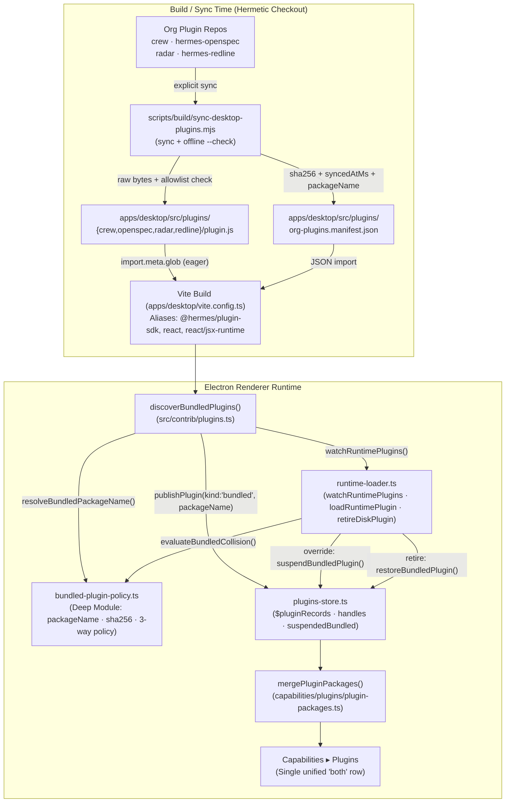

# Design: Always-Available Bundled Desktop Client Plugins (Hybrid PA 1)

## 1. Architecture Overview

The design keeps all rendering and loading inside Hermes Desktop's trusted local Vite bundle and existing `contrib/` loader architecture. One new deep module (`bundled-plugin-policy.ts`) owns all bundled-org metadata resolution, synchronous UTF-8 SHA-256 digesting, and 3-way bundled-vs-disk collision decisions behind a 3-function interface.



---

## 2. Module & Seam Design (`codebase-design` Principles)

### 2.1 Deep Module: `apps/desktop/src/contrib/bundled-plugin-policy.ts`
- **Role**: Single authoritative module for bundled organizational plugin metadata and bundled-vs-disk precedence.
- **Interface** (3 pure exports, zero side effects, zero DOM/Electron globals):
  ```ts
  export interface BundledOrgPluginEntry {
    readonly id: string
    readonly packageName: string
    readonly sha256: string
    readonly syncedAtMs: number
    readonly sourceHint: string
  }

  export interface DiskOverrideCandidate {
    readonly id: string
    readonly source: string
    readonly packageName?: string
    readonly linkedSource?: string
    readonly sourceMtimeMs?: number
  }

  export type BundledCollisionDecision =
    | { readonly action: 'override'; readonly reason: 'linked-dev' | 'newer-unified' }
    | { readonly action: 'dedup-bundled'; readonly reason: 'identical-unified' | 'older-unified' }
    | { readonly action: 'shadow-stale'; readonly reason: 'standalone-disk' }

  export function resolveBundledPackageName(
    plugin: { readonly id: string; readonly packageName?: string }
  ): string | undefined

  export function bundledOrgPluginMeta(id: string): BundledOrgPluginEntry | undefined

  export function sha256Hex(input: string): string

  export function evaluateBundledCollision(
    bundled: Pick<PluginRecord, 'id' | 'packageName'>,
    candidate: DiskOverrideCandidate,
    meta?: BundledOrgPluginEntry
  ): BundledCollisionDecision
  ```
- **Why pure synchronous `sha256Hex(input: string)`**:
  - `crypto.subtle.digest` is async and **undefined on plain-HTTP non-localhost Webapp origins** (the same reason `apps/desktop/eslint.config.mjs:44-56` bans `crypto.randomUUID`).
  - A compact (~55-line) pure TypeScript FIPS 180-4 SHA-256 implementation over `new TextEncoder().encode(input)` runs synchronously in <2 ms for a 235 KB `plugin.js`, works identically in Electron renderer, browser Webapp over HTTP, and Vitest/jsdom, and adds zero npm dependencies.
- **Deletion Test**: Removing `bundled-plugin-policy.ts` would scatter manifest parsing, scoped `packageName` checks, SHA-256 hashing, and 3-way collision branching across `plugins.ts`, `runtime-loader.ts`, and multiple test suites. Keeping them behind 3 pure functions yields high depth, locality, and direct testability at the seam.

### 2.2 Collision Precedence State Machine

```mermaid
stateDiagram-v2
    [*] --> BundledActive: discoverBundledPlugins()<br/>(kind='bundled', packageName scoped)

    BundledActive --> BundledActive: Disk scan finds standalone copy<br/>(no linkedSource, no matching packageName)<br/>action='shadow-stale' -> publish :disk-shadowed
    BundledActive --> BundledActive: Disk scan finds unified copy<br/>(sha256 equal OR sourceMtimeMs <= syncedAtMs)<br/>action='dedup-bundled' -> silent skip, no shadow row

    BundledActive --> DiskOverriding: Linked dev checkout (linkedSource set)<br/>OR newer unified copy (sha256 != & mtime > syncedAtMs)<br/>action='override' -> suspendBundledPlugin(id)

    DiskOverriding --> DiskOverriding: File edit / hot-reload<br/>(same file path -> unloadRuntimePlugin + re-register)
    DiskOverriding --> DiskError: Broken save / register() throw<br/>(status='error' on plugin row; bundled remains suspended)
    DiskError --> DiskOverriding: Fixing save -> reload succeeds
    DiskOverriding --> BundledActive: Folder removed / uninstalled<br/>retireDiskPlugin() -> restoreBundledPlugin(id)
    DiskError --> BundledActive: Folder removed / uninstalled<br/>retireDiskPlugin() -> restoreBundledPlugin(id)
```



### 2.3 Exact File Seams & Minimal Diff Surface

| File | Seam / Responsibility | Surgical Change |
| :--- | :--- | :--- |
| `apps/desktop/src/plugins/org-plugins.manifest.json` | New SSOT manifest | Lists `crew`, `openspec`, `radar`, `redline` with `id`, `packageName`, `sha256`, `syncedAtMs`, `sourceHint`. |
| `apps/desktop/src/plugins/{crew,openspec,radar,redline}/plugin.js` | New bundled plain-ESM modules | Byte-identical copies synced via `sync-desktop-plugins.mjs`; Vite eager glob loads them automatically via existing `@hermes/plugin-sdk`, `react`, `react/jsx-runtime` aliases. |
| `apps/desktop/src/contrib/bundled-plugin-policy.ts` | New deep policy module | Implements `resolveBundledPackageName`, `bundledOrgPluginMeta`, `sha256Hex`, `evaluateBundledCollision`. |
| `apps/desktop/src/contrib/plugin.ts` | Authoring contract interface | Add optional `readonly packageName?: string` on `HermesPlugin` (lines 195-212). |
| `apps/desktop/src/contrib/plugins-store.ts` | Lifecycle store seam | Add `suspendBundledPlugin(id): { defaultEnabled: boolean } \| null` and `restoreBundledPlugin(id): boolean` backed by a private `suspendedBundled` map storing `{ record, handle, defaultEnabled }`. Extend `publishPlugin(record, handle, meta?)` or track `defaultEnabled` on the handle registration so restore honors the bundled plugin's original `defaultEnabled`. |
| `apps/desktop/src/contrib/plugins.ts` | Bundled discovery seam | Compute `const packageName = resolveBundledPackageName(plugin)`; include `...(packageName ? { packageName } : {})` on `record` (lines 50-56). Pass `plugin.defaultEnabled ?? true` when publishing the bundled handle so `suspendBundledPlugin`/`restoreBundledPlugin` know the bundled default. |
| `apps/desktop/src/contrib/runtime-loader.ts` | Runtime disk loader seam | 1. Extend `PackageMarker`, `DiskPlugin`, and `LoadOptions` with `linkedSource?: string` and `sourceMtimeMs?: number` (preserving `parsed.sourceMtimeMs` in `packageMarker()` and `readFolderIdentity()`).<br>2. Replace the unconditional `if ($pluginRecords.get()[plugin.id]?.kind === 'bundled')` block (lines 447-459) with `evaluateBundledCollision(current, candidate)` handling `'override'`, `'dedup-bundled'`, and `'shadow-stale'`.<br>3. On `'override'`, call `suspendBundledPlugin(plugin.id)` and preserve the bundled default-enabled posture (`bundledDefault` instead of unified opt-in `false`) when evaluating `pluginActive()`, while still honoring explicit `$pluginDecisions[id] === false`.<br>4. In `retireDiskPlugin()` (lines 1031-1050), call `restoreBundledPlugin(record.id)` immediately after `dropPlugin(record.id)` so removing an override restores the bundled plugin live. |
| `apps/desktop/src/contrib/radio-plugin.test.ts` | Existing Radio integration test | Add `crew: false, openspec: false, radar: false, redline: false` to the test's `$pluginDecisions.set(...)` isolation fixture (lines 37, 64, 91, 122, 155) so Radio's `document.head` style-count assertion stays isolated from other default-enabled bundled plugins. |
| `scripts/build/sync-desktop-plugins.mjs` | Build/sync CLI tool | Deterministic Node ESM sync + offline `--check` verifier (imports allowlist, SHA-256 parity, no `crew/app.js`). |
| `apps/desktop/package.json` | Workspace scripts | Add `"sync:plugins": "node ../../scripts/build/sync-desktop-plugins.mjs"` and `"check:plugins": "node ../../scripts/build/sync-desktop-plugins.mjs --check"` under `"scripts"`. |

---

## 3. Bundler & Toolchain Verification

1. **Vite Resolution (`apps/desktop/vite.config.ts`)**:
   - Line 238: `'@hermes/plugin-sdk': path.resolve(__dirname, './src/sdk/index.ts')`
   - Line 256: `react: reactDir`
   - Line 258-259: `'react/jsx-dev-runtime'`, `'react/jsx-runtime'`
   - All 4 org plugins import exclusively from `@hermes/plugin-sdk`, `react`, and `react/jsx-runtime`, with `0` missing SDK exports and `0` dynamic imports.
   - `crew/desktop/app.js` (818 KB browser IIFE) has `0` references in `crew/desktop/plugin.js` and is explicitly excluded.
2. **TypeScript & ESLint (`tsconfig.json`, `eslint.config.mjs`)**:
   - `tsconfig.json` has `"allowJs": false` and `"resolveJsonModule": true`. Plain-ESM `.js` files under `src/plugins/*` are ignored by `tsc`, while `org-plugins.manifest.json` imports cleanly with strict typing.
   - `eslint.config.mjs` scopes rules to `**/*.{ts,tsx}` — matching upstream `src/plugins/radio/plugin.js`.
3. **Freshness Hashing (`scripts/build/freshness.mjs`)**:
   - Both `desktop` and `webapp` product input trees walk `apps/desktop` recursively (excluding `dist`, `build`, `node_modules`). Updating any bundled `plugin.js` or `org-plugins.manifest.json` automatically invalidates renderer freshness receipts.
   - Because `sync-desktop-plugins.mjs` is NOT invoked during `pnpm run build`, `recordProduct()`'s mid-build input immutability check (`freshness.mjs:198`) and `hermes update`'s clean-tree guarantee remain 100% preserved.

---

## 4. Sync Script Contract (`scripts/build/sync-desktop-plugins.mjs`)

- **CLI Flags**:
  - `(default)`: Sync mode — resolves each plugin source, validates allowlisted imports, copies exact raw bytes to `apps/desktop/src/plugins/<id>/plugin.js`, removes stray `crew/app.js` if present, writes sorted deterministic JSON to `apps/desktop/src/plugins/org-plugins.manifest.json`.
  - `--check`: Read-only offline verification mode — never accesses external repos or writes files. Exits `0` iff:
    1. `org-plugins.manifest.json` parses cleanly with `schemaVersion === 1` and contains exact ids `['crew', 'openspec', 'radar', 'redline']`.
    2. Every `apps/desktop/src/plugins/<id>/plugin.js` exists, is non-empty, and its SHA-256 equals `entry.sha256`.
    3. Every `plugin.js` imports ONLY specifiers in `{'@hermes/plugin-sdk', 'react', 'react/jsx-runtime', 'react/jsx-dev-runtime'}` (using a code-range-aware import scanner matching `runtime-loader.ts` so string literals/comments don't false-positive).
    4. No `apps/desktop/src/plugins/crew/app.js` exists.
  - `--plugins-root <dir>`: Optional override directory containing `<name>/desktop/plugin.js` (used for testing and custom environments).
  - `--source-map <json>`: Optional per-plugin explicit path override map.
- **Default Source Resolution Order (Sync Mode Only)**:
  1. `--source-map` entry for `<id>`
  2. `--plugins-root/<id>/desktop/plugin.js`
  3. Sibling OSS checkout relative to repo root (`../crew/desktop/plugin.js`, `../hermes-openspec/desktop/plugin.js`, `../radar/desktop/plugin.js`, `../hermes-redline/desktop/plugin.js`)
  4. `${HERMES_HOME}/plugins/<id>/desktop/plugin.js` (if `HERMES_HOME` env is set, else `~/.hermes/plugins/<id>/desktop/plugin.js`)
- **Timestamp Stability**: When a synced plugin's SHA-256 is **unchanged** from the existing manifest entry, preserve its existing `syncedAtMs` (unless `--touch` is passed) so re-running sync on unchanged sources produces a zero-byte git diff! When SHA-256 changes, set `syncedAtMs` to the source file's `Math.round(stat.mtimeMs)` (or `Date.now()` if newer? Use `Math.round(stat.mtimeMs)` of the source file so an immediately-subsequent reconcile of that exact same file on disk never falsely looks "newer" than the bundle!).
  - **Subtle NTFS/Copy Benefit**: Recording `syncedAtMs = Math.round(sourceStat.mtimeMs)` (the exact mtime of the source `plugin.js` when synced) guarantees that on a machine where the local plugin has NOT been modified since sync, `disk.sourceMtimeMs === manifest.syncedAtMs` AND `disk.sha256 === manifest.sha256` -> clean `dedup-bundled`! As soon as the user updates or edits the local plugin (`mtimeMs > syncedAtMs` and bytes change), it cleanly triggers `override`!

---

## 5. Negative Impact Analysis (3 Worst-Case Side Effects)

1. **Duplicate Contributions / Double Polling on Local Override**:
   - *Risk*: If a linked dev checkout or newer local unified package overrides a bundled plugin without disposing the bundled plugin's registrations first, both copies register status-bar chips, sidebar items, `<style>` tags, and `setInterval` pollers simultaneously — doubling UI chrome and network traffic.
   - *Mitigation*: `suspendBundledPlugin(id)` unconditionally invokes the bundled handle's `deactivate()` (disposing all `registry`, `onEvent`, `onDispose`, `socket`, and timer cleanups) BEFORE `loadRuntimePlugin()` calls `activate()` on the disk copy. Verified by unit tests asserting `bundledDeactivate` is called before `diskRegister` and contribution counts remain 1.
2. **Broken `radio-plugin.test.ts` or Upstream `hermes-bots` Shadow / Pairing Tests**:
   - *Risk*: Adding 4 default-enabled bundled plugins triggers style injection in `radio-plugin.test.ts`; overly broad `packageName` assignment would flip `hermes-bots`/`kanban`/`radio` to `kind: 'both'`; overly broad disk override would break `runtime-loader.test.ts`'s `hermes-bots:disk-shadowed` contract.
   - *Mitigation*: (a) `resolveBundledPackageName()` is strictly scoped to explicit `plugin.packageName` or `org-plugins.manifest.json`; (b) `evaluateBundledCollision()` preserves `'shadow-stale'` for all standalone disk copies; (c) `radio-plugin.test.ts` disables the 4 new bundled ids in its isolation fixture; (d) full `pnpm --filter hermes run test:ui` is a mandatory proof gate.
3. **Dirty Working Tree or Stale Bundled Drift Breaking `hermes update` / `freshness.mjs`**:
   - *Risk*: Running a file-copying sync script inside `apps/desktop/scripts/build.mjs` would mutate tracked files during `pnpm run build`, triggering `freshness.mjs` `"Build inputs changed during compilation"` and breaking `hermes update`'s clean-checkout invariant.
   - *Mitigation*: Bundled `plugin.js` files and `org-plugins.manifest.json` are committed artifacts; `build.mjs` never runs the sync writer; `sync-desktop-plugins.mjs --check` provides a strictly read-only offline integrity gate for CI and pre-release checks.
